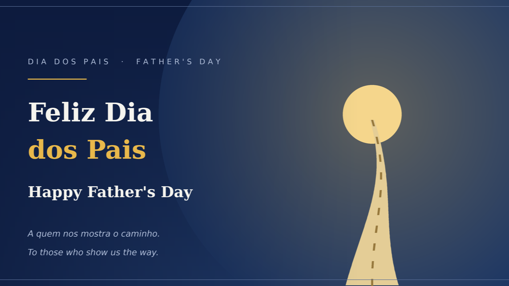

{fig-alt="Capa: Feliz Dia dos Pais / Happy Father's Day — a quem nos mostra o caminho."}

***Sobre o exemplo que recebemos e a responsabilidade de transmiti-lo.***

**Português**

**No Dia dos Pais, um agradecimento a todos que nos mostram o caminho.**

Hoje penso não só nos pais, mas em todos que exercem esse papel de nos guiar.

Recebemos muito de quem veio antes de nós. Dos nossos pais e avós herdamos valores, comportamentos e uma forma de enxergar o mundo. Muitas vezes o aprendizado não veio de um discurso, mas do exemplo — da maneira de trabalhar, de tratar as pessoas, de enfrentar as dificuldades sem desistir.

Ser pai é um papel que se exerce todos os dias, e em muitas frentes ao mesmo tempo. É prover e ajudar em casa, com recursos e com trabalho. É estar presente na vida dos filhos, não apenas por perto, mas junto. É acolher e incentivar a/o parceira(o), dividindo o peso e comemorando as conquistas. É continuar cuidando dos próprios pais, retribuindo o que um dia recebeu. E é, também, ser um bom amigo.

Assim como no trabalho, o que faz a diferença não é um gesto grandioso, mas a constância — a presença firme, dia após dia.

E esse papel não termina em casa. Ao longo da carreira, encontramos chefes e líderes que também assumem essa função: os que ensinam pelo exemplo, que compartilham lições, que corrigem com respeito e que se importam em nos ver crescer. São pessoas que entenderam que liderar é, antes de tudo, formar e se importar.

Com o tempo, percebemos que recebemos para depois entregar. Cabe a nós dar continuidade a esse ciclo — transmitir valores, atitudes e conhecimento a quem vem depois.

Porque, no fim, a maior responsabilidade de quem ensina não é formar apenas bons profissionais. É formar bons cidadãos, boas pessoas — prontas para os desafios que a vida e o trabalho vão apresentar.

**E você, quem foi essa pessoa na sua vida?** Aquele pai, avô, chefe ou mentor que te mostrou o caminho pelo exemplo? Deixe nos comentários uma homenagem a quem te ensinou a ser quem você é hoje. 👇

A todos os pais, avós, mentores e líderes que dão exemplo: obrigado por mostrarem o caminho. 🙏

**Feliz Dia dos Pais!**

 **English**

**On Father's Day, a thank-you to everyone who shows us the way.**

Today I think not only of fathers, but of everyone who takes on the role of guiding us.

We receive so much from those who came before us. From our parents and grandparents we inherit values, behaviors, and a way of seeing the world. Often the lesson didn't come from a speech, but from example — from the way they worked, treated people, and faced hardship without giving up.

Being a father is a role you carry out every day, and on many fronts at once. It's providing and helping at home, with resources and with work. It's being present in your children's lives — not just nearby, but truly with them. It's supporting and encouraging your partner, sharing the load and celebrating the wins. It's continuing to care for your own parents, giving back what you once received. And it's also being a good friend. Just like at work, what makes the difference isn't one grand gesture, but consistency — a steady presence, day after day.

And this role doesn't end at home. Throughout our careers, we meet bosses and leaders who take on this role too: those who teach by example, who share lessons, who correct with respect, and who genuinely care about seeing us grow. They understand that to lead is, above all, to shape people and to care.

Over time, we realize that we receive in order to give back. It's up to us to continue this cycle — passing on values, attitudes, and knowledge to those who come next.

Because in the end, the greatest responsibility of those who teach isn't only to shape good professionals. It's to shape good citizens, good people — ready for the challenges that life and work will bring.

**And you — who was that person in your life?** That father, grandfather, boss, or mentor who showed you the way by example? Leave a tribute in the comments to whoever taught you to be who you are today. 👇

To all the fathers, grandfathers, mentors, and leaders who lead by example: thank you for showing us the way. 🙏

**Happy Father's Day!**

---

*Publicado originalmente na newsletter **Radar**, no LinkedIn, em 09/08/2026. [Ver o artigo original e os comentários](https://www.linkedin.com/pulse/dia-dos-pais-fathers-day-c%C3%A9sar-ciuffo-dsuqf).*
