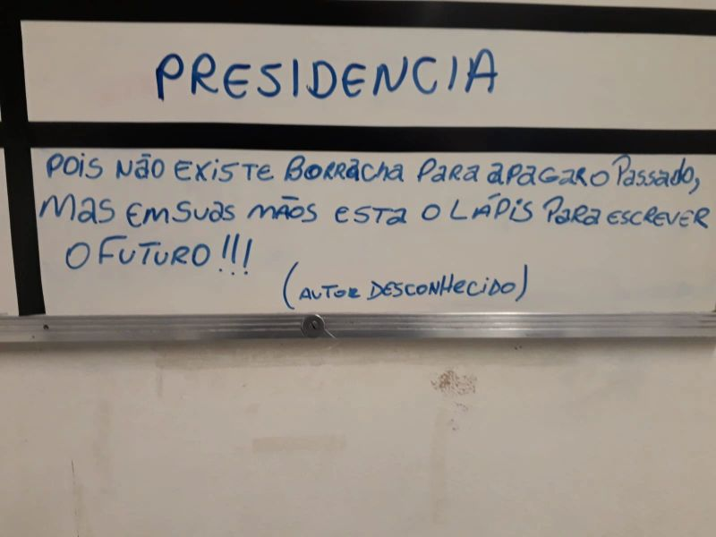

{fig-alt="Quadro branco com o título 'Presidência' e a frase escrita à mão em azul: 'Pois não existe borracha para apagar o passado, mas em suas mãos está o lápis para escrever o futuro!!! (autor desconhecido)'." width="600"}

> "Pois não existe borracha para apagar o passado, mas em suas mãos está o lápis para escrever o futuro!"
> — autor desconhecido

Foto aleatória de um quadro branco qualquer, com uma mensagem inspiradora para uma segunda-feira.

A vida recomeça todos os dias!

---

*Publicado originalmente no LinkedIn.*
