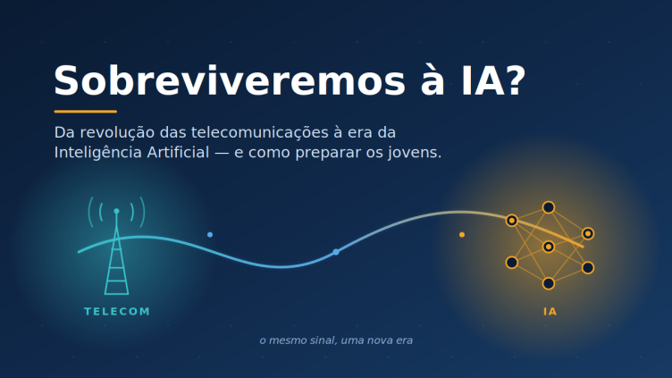

{fig-alt="Capa: Sobreviveremos à IA? Da revolução das telecomunicações à era da Inteligência Artificial — e como preparar os jovens. Uma onda liga uma torre de telecom a uma rede neural: o mesmo sinal, uma nova era."}

Há uma pergunta que ouço com frequência, quase sempre carregada de ansiedade: “Vamos sobreviver à Inteligência Artificial?”

Entendo o receio. Mas, sempre que ela aparece, eu volto no tempo — e respiro mais aliviado. Porque eu já vivi uma revolução tecnológica antes. E não só sobrevivi: ela me formou e faz parte do que sou hoje, pessoal e profissionalmente.

Comecei minha trajetória profissional no setor de telecomunicações, em um Brasil que estava sendo literalmente reconectado. Passei pela Americel, pela Claro, pela Tele Centro Oeste Celular, pela Vivo, pela Brasil Telecom e pela Oi em um período em que o país saía de filas de anos para conseguir uma linha telefônica e entrava na era do celular na palma da mão, da banda larga e da internet que mudaria tudo.

Quem não viveu aquilo talvez não dimensione o tamanho da transformação. Em poucos anos, profissões inteiras mudaram de forma. Centrais analógicas deram lugar a redes digitais. Processos manuais viraram sistemas. Havia, sim, o mesmo medo de hoje: “as máquinas vão substituir as pessoas”. Algumas funções de fato desapareceram. Mas surgiram outras que ninguém conseguia nem imaginar — e muitos de nós nos tornamos exatamente o que essas novas funções pediam.

Foi ali que aprendi a lição mais valiosa da minha carreira, e é dela que quero falar com os mais jovens.

***A tecnologia não substitui quem aprende a aprender. Ela amplifica.***

As empresas que me formaram não me entregaram apenas um cargo. Elas me entregaram uma mentalidade: a de que mudança não é ameaça, é matéria-prima para a transformação pessoal e para a competitividade profissional. Quem encarava a nova rede, a nova ferramenta, o novo sistema como inimigo, ficava para trás e obsoleto. Quem perguntava “o que eu consigo fazer agora que antes era impossível?” crescia junto com a tecnologia e progredia na carreira. Talento é algo raro e deve ser cultivado por você mesmo!

Essa pergunta vale palavra por palavra para a Inteligência Artificial (IA) hoje.

A IA vai automatizar tarefas. Vai, sim! Mas ela não automatiza julgamento, ética, contexto, sensibilidade, a capacidade de fazer a pergunta certa e de cuidar de outra pessoa, com empatia e respeito. Esses são territórios profundamente humanos — e, paradoxalmente, ficam mais valiosos quanto mais a máquina avança. O foco é a simbiose e a sinergia de trabalhar com a tecnologia. Sua vantagem competitiva é a capacidade de atuar integrado com a máquina e com o processo em que atua. Foque em seu processo decisório e a visão estratégica de onde atua!

Aos jovens de hoje e sempre, deixo três convicções que carrego desde aqueles anos de Telecom e que se aplicam inteiras à era da IA:

1.      **Dominem a ferramenta, mas não se definam por ela.** A linguagem de programação muda, o software muda, o modelo de IA muda a cada semana. O que permanece é a sua capacidade de raciocinar, aprender rápido e se reinventar. Invistam nisso, **mantenham-se abertos e priorizem aprender sempre!**

2.      **Experiência não é o oposto de futuro — é a bússola dele.** Existe um discurso de que o que veio antes “está ultrapassado”. Não está. A vivência ensina a separar o que é moda passageira do que é mudança estrutural. O ideal não é jovem contra experiente: é a fluência tecnológica das novas gerações somada ao discernimento de quem já atravessou outras transformações. Busquem assimilar com a vivência de quem já passou por isso, **valorizem atalhar o caminho com o aprendizado de outros**.

3.      **Usem a tecnologia para resolver problemas reais de pessoas reais.** Foi isso que deu sentido ao meu trabalho em Telecom, sempre buscar a necessidade do cliente e como podemos atendê-lo com mais facilidade e satisfação, e é isso que dá sentido hoje, quando atuo na fronteira entre dados, pessoas e tecnologia. **A IA só vale a pena se servir a alguém, buscando entender suas dores e como prover soluções adequadas e efetivas.**

Olhando para trás, vejo que a revolução das telecomunicações não me abandonou — ela me preparou para o futuro e o papel que exerço hoje na ApexBrasil. Me ensinou a não ter medo da onda seguinte, mas como me adaptar, preparar e a aprender a surfá-la.

Então, sobreviveremos à IA?

A pergunta, na verdade, é outra. Não se trata de sobreviver. Trata-se de decidir que tipo de protagonista cada um quer ser nessa nova fase. Eu já vi essa história acontecer uma vez. E posso garantir: o futuro não pertence a quem teme a tecnologia, nem a quem a idolatra. Pertence a quem nunca para de aprender.

***E você, qual revolução já te formou?***

---

*Publicado originalmente no LinkedIn, em 28/06/2026. [Ver o artigo original e os comentários](https://www.linkedin.com/pulse/sobreviveremos-%C3%A0-ia-o-que-revolu%C3%A7%C3%A3o-das-me-ensinou-sobre-c%C3%A9sar-ciuffo-8iilf).*
