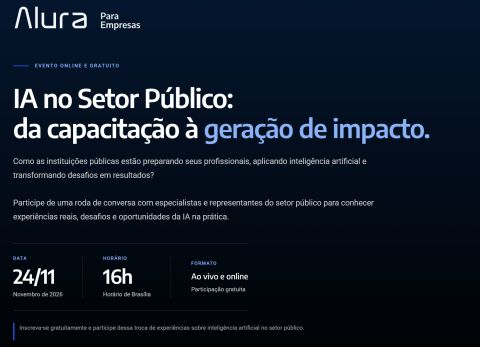

{fig-alt="Alura para Empresas — evento online e gratuito: IA no Setor Público, da capacitação à geração de impacto. 24 de novembro, 16h, horário de Brasília, ao vivo e online."}

No dia **24 de novembro de 2026, às 16h** (horário de Brasília), participo como convidado da roda de conversa **"IA no Setor Público: da capacitação à geração de impacto"**, promovida pela **Alura para Empresas**.

O encontro reúne especialistas e representantes do setor público para discutir como as instituições estão preparando seus profissionais, aplicando inteligência artificial e transformando desafios em resultados — com experiências reais, desafios e oportunidades da IA na prática.

- **Data:** 24/11/2026
- **Horário:** 16h (horário de Brasília)
- **Formato:** ao vivo e online
- **Participação:** gratuita

[Inscreva-se gratuitamente na página do evento](https://empresas.alura.com.br/ia-no-setor-publico-da-capacitacao-a-gera%C3%A7%C3%A3o-de-impacto){.btn .btn-primary}
