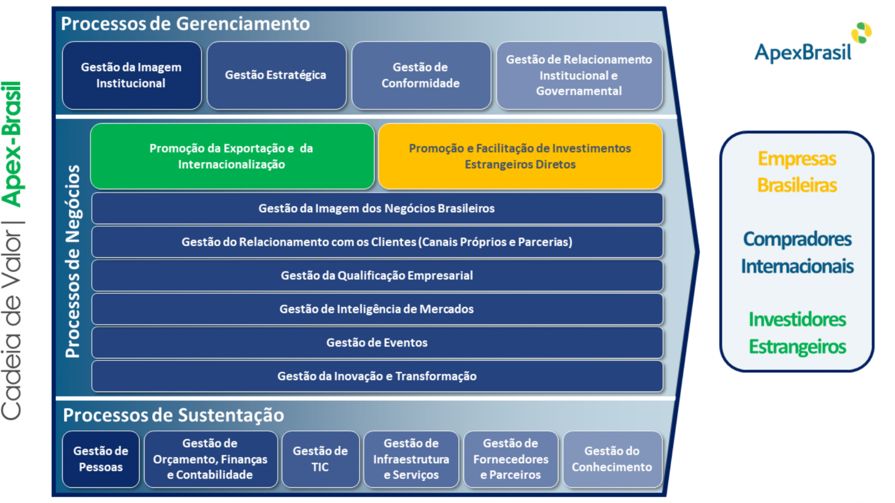

Entre 2020 e 2023, fui Gerente de Gestão Estratégica da Apex-Brasil e liderei o processo de **Planejamento Estratégico 2020–2023** da Agência. Reúno aqui os três documentos desse ciclo, do plano à avaliação final:

1. **Plano Estratégico 2020–2023** (4ª revisão, setembro de 2023): o que a Agência se propôs a fazer.
2. **Cadeia de Valor**: como a Agência se organiza em processos para entregar valor aos clientes.
3. **Relatório Global de Avaliação do Contrato de Gestão 2020–2023** (abril de 2024): o que foi alcançado.

::: {.callout-note appearance="simple"}
São documentos institucionais. Os direitos são da Apex-Brasil, que autoriza a divulgação desde que citada a fonte. **Fonte: Apex-Brasil – Agência Brasileira de Promoção de Exportações e Investimentos.** Os comentários neste texto são pessoais e não representam a posição oficial da Agência.
:::

## O Plano Estratégico 2020–2023

Foi a primeira vez que o planejamento da Agência foi coordenado por uma equipe interna, com a participação de todos os colaboradores, da Diretoria Executiva e do Conselho Deliberativo. O processo incluiu benchmarking com instituições internacionais semelhantes e palestras de sensibilização sobre os temas que afetariam a estratégia nos anos seguintes.

O plano parte da identidade estratégica da Agência:

- **Missão:** "Promover as exportações, a internacionalização das empresas brasileiras e os investimentos estrangeiros diretos, em apoio às políticas e estratégias públicas nacionais, a fim de contribuir para o crescimento sustentável da economia brasileira."
- **Visão:** "Ser reconhecida como a melhor Agência de promoção de exportação, internacionalização e investimentos até 2023."
- **Valores:** Ousadia, Compromisso, Foco no Cliente e Transparência.

Daí saem **12 objetivos estratégicos**, cada um com diretrizes, indicadores e metas anuais:

1. Reforçar o posicionamento do Brasil como parceiro global de negócios e divulgar as oportunidades comerciais no País e no exterior.
2. Gerar inteligência para empresas sobre oportunidades e riscos de mercados.
3. Ampliar a qualificação das empresas brasileiras e a sua competitividade para o mercado internacional.
4. Inserir e ampliar a presença de empresas brasileiras no mercado internacional.
5. Expandir a inserção das empresas brasileiras nas cadeias globais de valor, pela atração de investimentos estrangeiros diretos em setores prioritários.
6. Atuar em rede com parceiros estratégicos nacionais e internacionais.
7. Aprimorar o atendimento ao cliente e a sua jornada, de acordo com a sua maturidade, setor e mercado de atuação.
8. Realizar a transformação digital e consolidar a cultura de inovação.
9. Desenvolver colaboradores e líderes e assegurar um ambiente de trabalho justo e de confiança.
10. Evoluir o estágio de maturidade da Apex-Brasil em Governança e Compliance.
11. Prover e aprimorar soluções de Tecnologia de Informação e Comunicação, em atendimento às necessidades do negócio e da gestão.
12. Reduzir despesas e incrementar receitas de modo sustentável.

O plano foi revisado quatro vezes ao longo da vigência, sempre com aprovação do Conselho Deliberativo, para ajustar indicadores e metas à realidade, incluindo os efeitos da pandemia.

[Baixar o Plano Estratégico 2020–2023 (PDF, 58 páginas)](plano-estrategico-2020-2023-4a-revisao.pdf){.btn .btn-primary}

## A Cadeia de Valor

A estratégia só se realiza se os processos estiverem organizados para entregá-la. A Cadeia de Valor mostra a Agência em três camadas: **processos de gerenciamento**, **processos de negócio** (a promoção de exportações e da internacionalização, e a promoção e facilitação de investimentos estrangeiros diretos) e **processos de sustentação**. Tudo isso é orientado a três públicos: empresas brasileiras, compradores internacionais e investidores estrangeiros.

{fig-alt="Diagrama da Cadeia de Valor da Apex-Brasil. Processos de Gerenciamento: Gestão da Imagem Institucional, Gestão Estratégica, Gestão de Conformidade, Gestão de Relacionamento Institucional e Governamental. Processos de Negócios: Promoção da Exportação e da Internacionalização; Promoção e Facilitação de Investimentos Estrangeiros Diretos; Gestão da Imagem dos Negócios Brasileiros; Gestão do Relacionamento com os Clientes; Gestão da Qualificação Empresarial; Gestão de Inteligência de Mercados; Gestão de Eventos; Gestão da Inovação e Transformação. Processos de Sustentação: Gestão de Pessoas; Orçamento, Finanças e Contabilidade; TIC; Infraestrutura e Serviços; Fornecedores e Parceiros; Gestão do Conhecimento. Clientes: Empresas Brasileiras, Compradores Internacionais, Investidores Estrangeiros."}

[Baixar a Cadeia de Valor (PDF)](cadeia-de-valor-apex-brasil.pdf){.btn .btn-outline-primary}

## O Relatório Global de Avaliação

Ao fim do ciclo, a Agência prestou contas do cumprimento das metas e obrigações do **Contrato de Gestão 2020–2023** firmado com o Governo Federal. O relatório percorre os 12 objetivos estratégicos, organizados nas perspectivas da Sociedade, dos Processos Internos e da Sustentabilidade.

Entre os destaques do período, o relatório registra:

- **17.064 empresas apoiadas** em 2023, um recorde, com atenção especial às micro e pequenas empresas;
- a participação do Brasil na **Expo 2020 Dubai**;
- a certificação **NBR ISO 9001** do atendimento setorial direto às empresas em feiras internacionais, em 2022;
- o lançamento da **Plataforma Brasil Exportação** e do programa **Exporta Mais Brasil**, em 2023.

[Baixar o Relatório Global de Avaliação 2020–2023 (PDF, 79 páginas)](relatorio-global-de-avaliacao-2020-2023.pdf){.btn .btn-primary}
