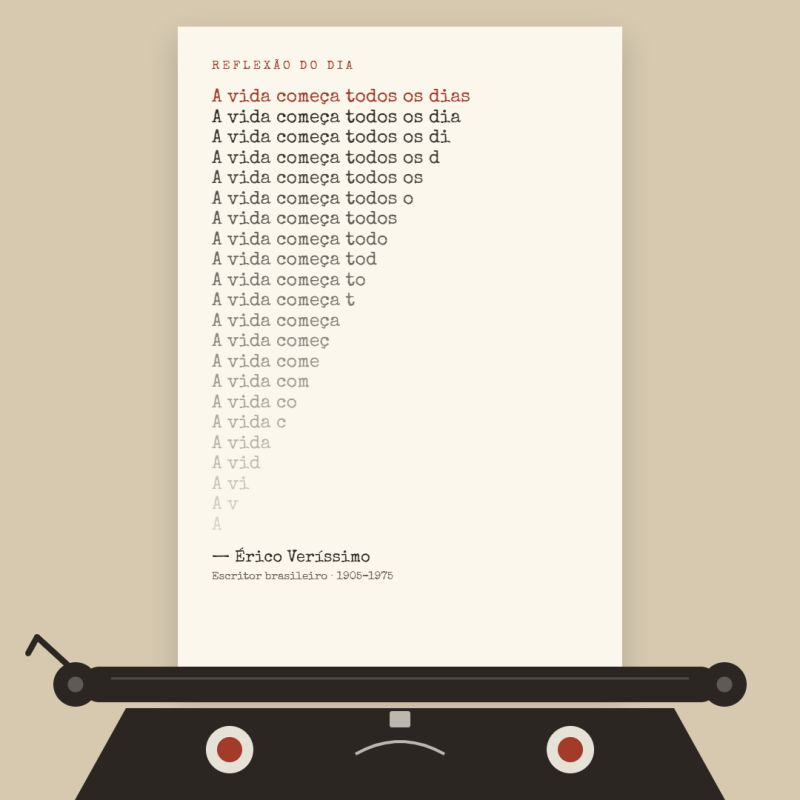

{fig-alt="Folha saindo de uma máquina de escrever com a frase 'A vida começa todos os dias' repetida, perdendo uma letra por linha até sobrar só o 'A'. Assinatura: Érico Veríssimo, escritor brasileiro, 1905–1975." width="560"}

> "A vida começa todos os dias."
> — frase atribuída a Érico Veríssimo

Na arte, repeti a frase tirando uma letra por linha, até sobrar só o "A". Foi a forma mais simples que encontrei de mostrar algo que todos sabemos, mas esquecemos no meio da rotina: o tempo é finito.

No trabalho, isso muda a perspectiva. A conversa difícil que vivemos adiando. O reconhecimento que ficou para depois. O projeto que "um dia" sai do papel.

Cada dia é um convite de começar e, ao mesmo tempo, uma chance a menos de fazer.

Recomeçar todos os dias não é otimismo ingênuo. É responsabilidade madura com o tempo que temos e com as pessoas com quem o dividimos.

Seja feliz!

---

*Publicado originalmente no LinkedIn.*
