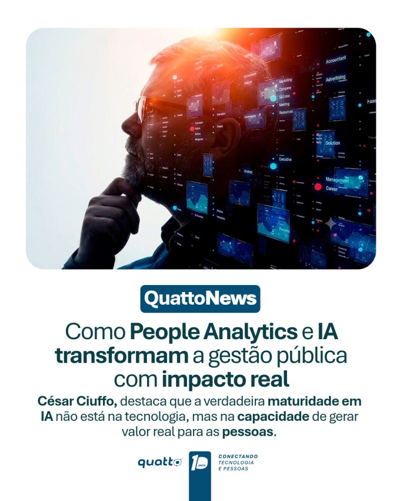

Participei do episódio **#34 do QuattoCast**, o podcast da Quatto, para conversar sobre como **pessoas, dados e tecnologia** podem andar juntos.



A conversa também virou destaque na **QuattoNews**: *Como People Analytics e IA transformam a gestão pública com impacto real.* A mensagem central é que a verdadeira maturidade em IA não está na tecnologia, mas na capacidade de gerar valor real para as pessoas.

::: {layout-ncol=2}
{fig-alt="Arte de divulgação do QuattoCast 34 com a foto de César Ciuffo, Apex-Brasil, Especialista de Promoção de Exportações e Atração de Investimentos: Pessoas, dados e tecnologia unidos."}

{fig-alt="QuattoNews: Como People Analytics e IA transformam a gestão pública com impacto real. César Ciuffo destaca que a verdadeira maturidade em IA não está na tecnologia, mas na capacidade de gerar valor real para as pessoas."}
:::

---

*Divulgado também [no LinkedIn](https://www.linkedin.com/feed/update/urn:li:activity:7521598422014160896/).*
