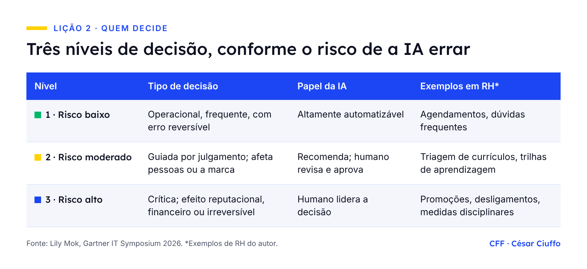
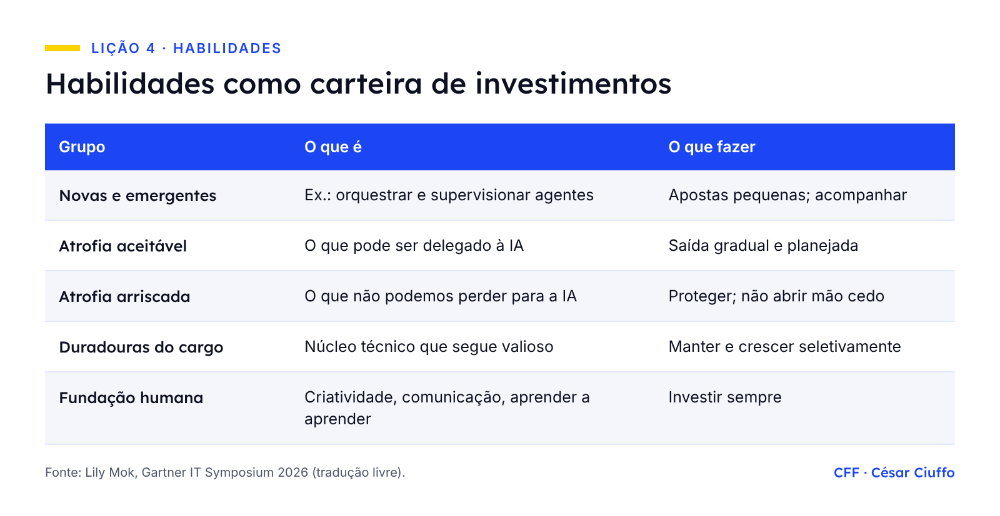

{fig-alt="Capa: IA, trabalho e pessoas — 6 lições de um evento de tecnologia para a Gestão de Pessoas. Gartner IT Symposium 2026."}

De 19 a 22 de outubro, estive em Orlando no Gartner IT Symposium/Xpo 2026, o maior evento anual de CIOs e líderes de tecnologia. Assisti a 22 sessões. Fui esperando ouvir sobre modelos, nuvem e dados. Voltei com um caderno cheio de anotações sobre papéis, habilidades, carreira e confiança.

Não foi impressão minha. Na sessão de Frank Buytendijk sobre colaboração humano-IA, 62% dos participantes apontaram esse tema como prioridade. O fio condutor de toda a conferência era gerar valor com IA de forma composta, sem perder o controle do risco. E, em quase todas as trilhas, a resposta passava por redesenho do trabalho, habilidades e governança.

Trabalho com Gestão de Pessoas e People Analytics, então li o evento por essa lente. Abaixo estão as seis lições que, para mim, mais importam para quem cuida de gente. As opiniões são pessoais.

### 1. O valor da IA cresce devagar. O risco cresce rápido.

O keynote de abertura trouxe um diagnóstico desconfortável. Segundo pesquisas do Gartner, 58% dos líderes de área dizem obter valor positivo das iniciativas de IA de 2025. Mas só 1 em cada 5 casos de uso entrega retorno positivo. E 86% dos Líderes de TI dizem que o risco da IA cresce mais rápido que o valor: em média, quatro vezes mais rápido.

O Gartner separou esse risco em três tipos. Há quem use IA para atacar a organização de fora. Há tecnologia insegura entrando no ambiente. E há o **mau julgamento**: empregados bem-intencionados que decidem mal usando IA.

Esse terceiro risco não se resolve com firewall. Depende de letramento em IA, de cultura e de clareza sobre quem decide o quê. Ou seja, é um tema de RH. O mesmo vale para a "IA paralela", o uso de ferramentas sem aprovação nem supervisão. O recado do keynote foi direto: atividade de IA invisível vira, cedo ou tarde, risco visível.

O keynote também deu nome a quem mais gera valor: os "artesãos de IA", usuários avançados que reinventam o próprio trabalho. São poucos em qualquer organização. A recomendação é encontrá-los, pedir que compartilhem o que fazem e dar espaço para experimentar, porque controle demais afasta exatamente essas pessoas.

### 2. Antes de automatizar, decida quem decide

A sessão de Lily Mok foi, para mim, a mais importante do evento. Os números mostram um consenso sem método: 78% dos Líderes de Recursos Humanos concordam que fluxos e papéis precisam mudar para extrair valor da IA. Mas 74% dizem que os líderes de negócio não sabem fazer esse redesenho. Entre os Líderes de TI, só 16% se sentem capazes.

A proposta dela é classificar as decisões pelo risco de a IA errar:

{fig-alt="Tabela: três níveis de decisão conforme o risco de a IA errar. Nível 1, risco baixo: decisão operacional, frequente, com erro reversível; IA altamente automatizável; exemplos em RH: agendamentos e dúvidas frequentes. Nível 2, risco moderado: decisão guiada por julgamento, que afeta pessoas ou a marca; a IA recomenda e um humano revisa e aprova; exemplos: triagem de currículos e trilhas de aprendizagem. Nível 3, risco alto: decisão crítica, com efeito reputacional, financeiro ou irreversível; o humano lidera a decisão; exemplos: promoções, desligamentos e medidas disciplinares. Os exemplos de RH são do autor."}

Entre o "só humano" e o "totalmente autônomo", o Gartner descreveu sete graus de delegação. O ponto central: a escolha deve seguir a necessidade da organização, não o que a tecnologia consegue fazer. E vale a pena: quem já planeja redesenhar papéis para equipes de humanos e agentes tem 2,4 vezes mais chance de gerar alto valor com IA.

### 3. Automatizamos tarefas, não empregos. Mas os papéis ficaram parados.

Mandi Bishop falou de saúde, mas a ideia vale para qualquer organização. Os papéis foram desenhados para um mundo em que humanos executam. A IA absorve tarefas, e o papel continua igual. Ela descreveu três estágios:

1. **Papel 1.0, execução de tarefas:** muitas decisões, pouca consequência.
2. **Papel 2.0, mediação de decisões:** o humano cuida das exceções e da ambiguidade. O risco é virar gargalo.
3. **Papel 3.0, governança do sistema:** o humano desenha, supervisiona e governa. Poucas decisões, alta consequência.

O exemplo dela me marcou: o profissional assistido por IA deixou de fazer o trabalho burocrático, mas as metas continuaram as mesmas. Quando isso acontece, medir "quantos processos por dia" deixa de fazer sentido.

A frase que levei para casa: **o planejamento da força de trabalho vai tratar mais de capacidade de decisão do que de headcount.** Os casos apresentados vão nessa direção. Na CBRE, times de 8 a 9 pessoas com papéis rígidos viraram times de 3 a 4 com agentes, organizados por habilidade e não por cargo. No LinkedIn, atendentes passaram a cuidar dos casos complexos, enquanto a IA reúne a informação que antes eles buscavam.

### 4. Trate habilidades como uma carteira de investimentos

Esta foi a ideia mais prática que ouvi. Em vez de uma lista única de competências, o Gartner propõe separar as habilidades em cinco grupos, cada um com uma estratégia:

{fig-alt="Tabela: habilidades como carteira de investimentos. Novas e emergentes, como orquestrar e supervisionar agentes: apostas pequenas e acompanhamento. Atrofia aceitável, o que pode ser delegado à IA: saída gradual e planejada. Atrofia arriscada, o que não podemos perder para a IA: proteger e não abrir mão cedo. Duradouras do cargo, o núcleo técnico que segue valioso: manter e crescer seletivamente. Fundação humana, como criatividade, comunicação e aprender a aprender: investir sempre."}

A linha mais importante é a da "atrofia arriscada". No exemplo do Gartner, para um engenheiro de software, programar tarefas rotineiras pode ir para a IA. Já revisar código a fundo e ensinar os mais novos não. Perder essas habilidades deixa a equipe frágil.

Para levar isso à conversa individual, Lily Mok sugeriu um "perfil de valor do empregado". É um registro simples de onde a IA já ajuda, quais forças preservar, o que delegar e quais os próximos passos de desenvolvimento. Cabe em qualquer ciclo de desenvolvimento que já exista.

### 5. O jeito de falar da IA define a adoção

Helen Poitevin abriu a sessão dela com a história da milha em menos de 4 minutos. Depois que Roger Bannister provou que era possível, e com treino e tênis melhores, muitos atletas conseguiram. A IA seria o tênis: não substitui o atleta, muda o que é possível.

Ela comparou dois jeitos de comunicar a IA (frases em tradução livre):

- **Escassez:** "Não vamos repor quem sair; a IA fará o trabalho." Ou: "Quais das suas tarefas podemos passar para a IA?"
- **Abundância:** "A IA faz parte de como vamos cumprir a nossa missão." Ou: "Pense em como a IA poderia ajudar a resolver o problema."

A mentalidade de escassez leva a jogo de soma zero e a decisões de curto prazo. E as pessoas percebem. Na pesquisa global do Gartner com 5.692 empregados que devem usar IA, cerca de metade está entusiasmada e menos de 1 em 4 está frustrada. Ainda assim, 47% foram classificados como resistentes à IA. Isso apesar de o Gartner prever que, a partir de 2028, a IA passa a criar mais empregos do que elimina.

Frank Buytendijk resumiu bem esse paradoxo: **as pessoas não temem que a IA faça o seu trabalho; temem que a liderança acredite nisso.** Transparência sobre a intenção é, portanto, tarefa de quem cuida da comunicação com as pessoas.

Há um efeito de longo prazo que me preocupa mais. Se a IA faz o trabalho de entrada, onde os profissionais em início de carreira vão aprender? O Gartner listou essa sequência de riscos: atrofia de habilidades, dependência da IA, impacto no bem-estar, colapso das trilhas de carreira e, por fim, um pipeline de talentos vazio.

### 6. "Humano no circuito" não basta. É preciso humano no controle.

Sarah Baumunk trouxe o alerta mais incômodo do evento: aprovar não é o mesmo que supervisionar. Quem sempre clica em "Aprovar" não está governando a IA. Está apenas assumindo a responsabilidade pelo que ela fez.

A analogia dela foi o GPS. Primeiro, o mapa apoia o nosso raciocínio. Depois, o GPS pensa por nós e só seguimos. No fim, sem GPS, ficamos perdidos. Com a IA, delegamos também o julgamento, e ele enfraquece com o tempo.

A saída proposta tem três partes: **transparência** (saber o que foi feito por humano e o que foi feito por IA), **controle** proporcional ao risco (aprovar, editar, pausar ou desligar) e **agência** (o direito humano de escolher). Para o RH, isso vira capacitação: ensinar as pessoas a avaliar o que a IA entrega, e não só a usá-la.

Governança, aqui, não significa burocracia. O caminho seguro precisa ser o caminho fácil. A HEINEKEN mostrou um modelo simples: uma lista curta do que é livre (preparar reuniões, rascunhos para revisão) e do que exige pausa (dados sensíveis, publicação externa, decisões automatizadas). Para quem lida com dados de pessoas, e no Brasil com a LGPD, essa segunda lista é quase toda a nossa rotina.

### Quando a IA vira infraestrutura, as pessoas são o diferencial

A frase que fechou minha participação veio de Mandi Bishop, em tradução livre: quando a IA vira infraestrutura, a força de trabalho é tudo. Tecnologia e boas práticas se espalham rápido. O que não se copia é como cada organização desenha o trabalho, protege a atenção das pessoas e governa o julgamento.

Por isso a mensagem para o RH é simples: o redesenho do trabalho com IA não pode ficar só com a TI. O Gartner recomenda que Líderes de TI e Líderes de Recursos Humanos sejam coautores desse redesenho. Na minha leitura, é o momento de o RH sair da posição de quem treina depois e entrar como quem desenha junto.

Volto de Orlando com três perguntas que ainda estou respondendo. Gostaria de ouvir as suas respostas nos comentários do [artigo no LinkedIn](https://www.linkedin.com/pulse/um-evento-de-tecnologia-em-que-o-assunto-era-gente-c%25C3%25A9sar-ciuffo-x9qhf/):

1. Qual processo de RH você redesenharia primeiro com IA?
2. Quais habilidades da sua equipe vocês não podem perder para a IA?
3. Que decisões sobre pessoas devem ser sempre humanas?

::: {.callout-note appearance="minimal"}
*Fontes: sessões do Gartner IT Symposium/Xpo 2026 (Orlando, 19 a 22 de outubro), entre elas o keynote "Shaping Momentum: Compounding AI Value and Risk" e as sessões de Lily Mok, Helen Poitevin, Mandi Bishop, Sarah Baumunk, Frank Buytendijk e Frank Iannella (HEINEKEN USA). Traduções livres. As opiniões são pessoais e não representam a instituição onde trabalho. Publicado originalmente no [LinkedIn](https://www.linkedin.com/pulse/um-evento-de-tecnologia-em-que-o-assunto-era-gente-c%25C3%25A9sar-ciuffo-x9qhf/) em 8 de novembro de 2026.*
:::
