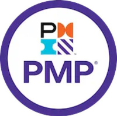
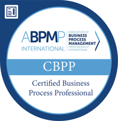

<!--
LOGOS DAS EMPRESAS
Coloque o arquivo do logo em imagens/empresas/ com o nome indicado em cada item
(ex.: imagens/empresas/apexbrasil.png). Enquanto o arquivo não existir, a página
mostra um selo com as iniciais da empresa.
-->

```{=html}
<div class="traj-numeros">
  <div><strong>25+</strong><span>anos de carreira</span></div>
  <div><strong>6</strong><span>organizações</span></div>
  <div><strong>250+</strong><span>profissionais certificados em gestão de projetos</span></div>
  <div><strong>28</strong><span>analistas de dados formados em parceria com o ITA</span></div>
</div>

<ol class="trajetoria">

  <li class="traj-item">
    <div class="traj-logo logo-cheio logo-apex">
      
      <span class="traj-sigla">AB</span>
    </div>
    <div class="traj-card">
      <div class="traj-topo">
        <h2>Apex-Brasil</h2>
        <span class="traj-periodo">jun/2011 – atual</span>
      </div>
      <p class="traj-empresa">Agência Brasileira de Promoção de Exportações e Investimentos · Brasília/DF</p>

      <h3>Assessor da Gerência de Recursos Humanos <span class="traj-tag">atual</span></h3>
      <ul>
        <li>Implantação de <strong>People Analytics</strong>, do sistema de monitoramento e compliance de RH e da ferramenta de Experiência do Colaborador.</li>
        <li>Parceria com o <strong>ITA</strong> para formar 28 analistas de dados na Agência (MBA em Ciência de Dados).</li>
      </ul>

      <h3>Gerente de Gestão Estratégica <span class="traj-tag">2020 – 2023</span></h3>
      <ul>
        <li>Liderança do <strong>Planejamento Estratégico 2020–2023</strong>, gestão dos indicadores de resultado (KPIs) e suporte ao Contrato de Gestão.</li>
        <li>Consultoria interna em estratégia, projetos (PMO), processos e riscos; benchmarking com agências de promoção comercial e atração de investimentos.</li>
        <li>Certificação <strong>NBR ISO 9001</strong> da Agência (2022), no escopo de promoção de exportação e de internacionalização por meio do atendimento setorial direto às empresas brasileiras em feiras internacionais.</li>
      </ul>

      <h3>PMO e escritório de processos</h3>
      <ul>
        <li>Implantação do <strong>PMO corporativo</strong> e criação do Referencial Básico de Gestão de Projetos; estruturação de grandes projetos, como a <strong>Expo Dubai 2020</strong>.</li>
        <li>Escritório de processos: arquitetura de processos corporativa, normativos de processos e riscos, Regimento Interno e sistema normativo.</li>
        <li>Programa de capacitação em gestão de projetos com <strong>mais de 250 profissionais certificados</strong>.</li>
      </ul>

      <h3>Inteligência Comercial e Produtos</h3>
      <ul>
        <li>Missões de inteligência comercial aos <strong>EUA</strong> (Washington, Miami e Chicago), <strong>Emirados Árabes Unidos</strong> (Dubai), <strong>Colômbia</strong> (Bogotá) e <strong>Japão</strong> (Tóquio).</li>
        <li>Estudos setoriais para apoiar a decisão de empresários, incluindo estudo comercial para o setor de Defesa em parceria com o Ministério da Defesa.</li>
        <li>Concepção do modelo de Gestão do Conhecimento e da 1ª versão da plataforma <strong>Passaporte para o Mundo</strong>.</li>
      </ul>
    </div>
  </li>

  <li class="traj-item">
    <div class="traj-logo">
      
      <span class="traj-sigla">PC</span>
    </div>
    <div class="traj-card">
      <div class="traj-topo">
        <h2>Plano Consultoria</h2>
        <span class="traj-periodo">jun/2010 – jun/2011</span>
      </div>
      <p class="traj-empresa">Gerente da Qualidade e Consultor Sênior de Projetos</p>
      <ul>
        <li>Planejamento estratégico, escritórios de projetos e gestão de processos para entidades públicas: Conselho da Justiça Federal, Ministério do Turismo, Exército Brasileiro e Terracap.</li>
        <li>Remodelagem do Sistema de Gestão da Qualidade e certificação <strong>ISO 9001:2008</strong>.</li>
      </ul>
    </div>
  </li>

  <li class="traj-item">
    <div class="traj-logo">
      
      <span class="traj-sigla">NT</span>
    </div>
    <div class="traj-card">
      <div class="traj-topo">
        <h2>Grupo NT</h2>
        <span class="traj-periodo">set/2009 – jun/2010</span>
      </div>
      <p class="traj-empresa">Gerente de Consultoria e Serviços</p>
      <ul>
        <li>Unificação de seis áreas de operações de TIC e gestão das entregas de seis contratos licitados.</li>
        <li>Recuperação de <strong>US$ 2 milhões</strong> em receita operacional e reestruturação do data center.</li>
        <li>Projetos de gestão do conhecimento, faturamento, ERP e portais corporativos.</li>
      </ul>
    </div>
  </li>

  <li class="traj-item">
    <div class="traj-logo">
      
      <span class="traj-sigla">BrT</span>
    </div>
    <div class="traj-card">
      <div class="traj-topo">
        <h2>Brasil Telecom <small>(atual Oi)</small></h2>
        <span class="traj-periodo">mar/2005 – jul/2009</span>
      </div>
      <p class="traj-empresa">Gerente de Soluções Integradas · Gerente de Marketing · Gerente de Qualidade de Produtos e Serviços</p>
      <ul>
        <li>Frente de Inovação de TI e implantação do <strong>Escritório de Projetos de TI</strong>, com portfólio de 500 projetos prioritários.</li>
        <li>Lançamento e gestão técnica de <strong>140 produtos, ofertas e serviços</strong> em 2008/2009, com cerca de 450 mil clientes adquiridos e fidelizados.</li>
        <li>KPIs, gestão de riscos e controles operacionais; processos auditados e certificados pela <strong>Lei Sarbanes-Oxley (SOX)</strong>.</li>
      </ul>
    </div>
  </li>

  <li class="traj-item">
    <div class="traj-logo">
      
      <span class="traj-sigla">V</span>
    </div>
    <div class="traj-card">
      <div class="traj-topo">
        <h2>Vivo / Tele Centro Oeste Celular</h2>
        <span class="traj-periodo">mar/2002 – mar/2005</span>
      </div>
      <p class="traj-empresa">Coordenador de Projetos e Processos – Integração e Melhoria</p>
      <ul>
        <li>Coordenação na <strong>fusão da Tele Centro Oeste Celular com a Vivo</strong>: arquitetura organizacional regional e integração com a nova matriz. Ganhos de sinergia mapeados de <strong>US$ 35 milhões</strong>, o melhor resultado no ranking de fusão do Grupo Vivo.</li>
        <li>Gerência da Qualidade da Vivo Centro-Oeste/Norte e certificação <strong>ISO 9001:2000</strong> dos processos de 12 estados.</li>
        <li>Gerente de produto da linha pós-paga e analista de faturamento da Norte Brasil Telecom.</li>
      </ul>
    </div>
  </li>

  <li class="traj-item">
    <div class="traj-logo">
      
      <span class="traj-sigla">C</span>
    </div>
    <div class="traj-card">
      <div class="traj-topo">
        <h2>Claro</h2>
        <span class="traj-periodo">out/2000 – mar/2002</span>
      </div>
      <p class="traj-empresa">Analista de Marketing</p>
      <ul>
        <li>Precificação e planejamento de demanda de aparelhos celulares e treinamento dos canais de vendas.</li>
        <li>Melhor desempenho de compras, distribuição e estoque de aparelhos do Grupo Claro em 2001.</li>
      </ul>
    </div>
  </li>

</ol>
```

## Certificações

```{=html}
<div class="certificacoes">
  <div class="cert">
    <div class="cert-logo">
      
      <span class="cert-sigla">PMP®</span>
    </div>
    <div><strong>Project Management Professional (PMP®)</strong><span>Project Management Institute (PMI) · 2011</span></div>
  </div>
  <div class="cert">
    <div class="cert-logo">
      
      <span class="cert-sigla">CBPP®</span>
    </div>
    <div><strong>Certified Business Process Professional (CBPP®)</strong><span>ABPMP · 2021</span></div>
  </div>
</div>
```

A formação acadêmica está na página [Sobre](about.qmd), e os artigos em [Publicações](publicacoes.qmd).
